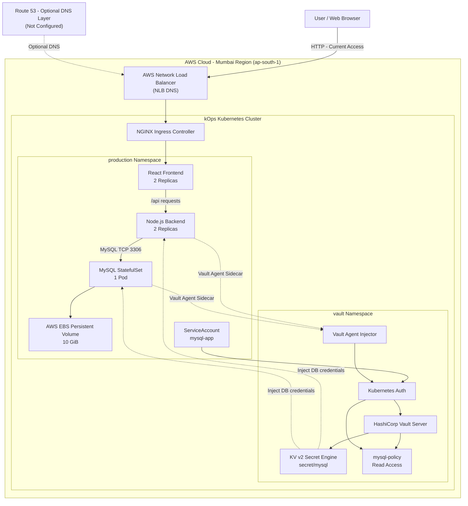

# Vault-Based Secure Employee Management Application on Kubernetes

A containerized Employee Management Application deployed on an AWS Kubernetes cluster using kOps. HashiCorp Vault is integrated with Kubernetes to securely manage and inject MySQL database credentials into application workloads.

---

## 1. Project Overview

This project demonstrates how to deploy a frontend, backend, and MySQL database on Kubernetes while using HashiCorp Vault for centralized secret management.

Instead of storing database credentials directly inside application deployment files, the application retrieves credentials securely from Vault through the Vault Agent Injector.

### Main objectives

- Deploy a React frontend and Node.js backend on Kubernetes.
- Deploy MySQL using a StatefulSet and persistent storage.
- Integrate HashiCorp Vault with Kubernetes authentication.
- Store database credentials securely in Vault KV v2.
- Inject secrets into application pods using Vault Agent Injector.
- Expose the application using NGINX Ingress and AWS Network Load Balancer.
- Run multiple frontend and backend replicas.

---

## 2. Architecture Diagram

The following diagram represents the application architecture and communication flow.



### How the architecture works

1. **User:** Opens the application using the AWS NLB DNS address.
2. **AWS NLB:** Receives incoming HTTP traffic and forwards it to the Kubernetes Ingress Controller.
3. **NGINX Ingress:** Routes incoming application traffic to the frontend service.
4. **React Frontend:** Displays the employee management dashboard.
5. **Node.js Backend:** Handles API requests and communicates with MySQL.
6. **MySQL:** Stores employee records and uses AWS EBS for persistent storage.
7. **HashiCorp Vault:** Stores database username and password in KV v2.
8. **Kubernetes Authentication:** Allows authorized workloads to authenticate with Vault.
9. **Vault Agent Injector:** Injects database credentials into the backend and MySQL pods as files.

**Important:** Route 53 is shown as an optional future DNS layer. The current application is accessed directly through the AWS NLB DNS address.

---

## 3. Technology Stack

| Category | Technology |
|---|---|
| Cloud Provider | AWS |
| Kubernetes | kOps |
| Container Runtime | containerd |
| Containerization | Docker |
| Frontend | React.js |
| Backend | Node.js |
| Web Server | NGINX |
| Database | MySQL 8.0 |
| Secret Management | HashiCorp Vault |
| Authentication | Kubernetes Authentication |
| Secret Injection | Vault Agent Injector |
| Storage | AWS EBS |
| Application Exposure | NGINX Ingress Controller |
| Load Balancer | AWS Network Load Balancer |
| Package Management | Helm |

---

## 4. Project Features

### Application
- React-based employee dashboard.
- Node.js REST API.
- MySQL database integration.
- Employee data retrieval.
- Frontend and backend horizontal replicas.

### Kubernetes
- Namespace-based resource organization.
- Deployments and StatefulSet.
- ClusterIP Services.
- NGINX Ingress Controller.
- PersistentVolumeClaim for MySQL.

### Vault Security
- KV version 2 secret storage.
- Kubernetes authentication.
- Vault roles and ACL policies.
- Vault Agent Injector.
- Database credential injection.
- No hardcoded application database password in Deployment YAML.

---

## 5. Repository Structure

```text
vault-kubernetes-employee-app/
│
├── README.md
│
├── architecture/
│   └── architecture.png
│
├── kubernetes/
│   ├── mysql-deployment.yaml
│   ├── backend-deployment.yaml
│   ├── frontend-deployment.yaml
│   ├── frontend-nginx.yaml
│   └── app-ingress.yaml
│
├── vault/
│   ├── mysql-policy.hcl
│   └── vault-role-setup.md
│
├── docs/
│   ├── implementation-steps.md
│   ├── testing-and-validation.md
│   └── security-configuration.md
│
└── screenshots/
    ├── vault-ui.png
    ├── vault-secret.png
    ├── backend-pods.png
    ├── frontend-dashboard.png
    ├── mysql-data.png
    └── application-access.png
```

---

## 6. Application Communication Flow

### Frontend to Backend

The frontend communicates with the backend through the `/api` path.

```text
Browser
   |
   v
AWS NLB
   |
   v
NGINX Ingress
   |
   v
Frontend Service
   |
   v
React Frontend
   |
   | /api/employees
   v
NGINX Reverse Proxy
   |
   v
Backend Service
   |
   v
Node.js Backend
```

### Backend to MySQL

```text
Node.js Backend
       |
       | Database Connection
       v
 backend-service
       |
       v
 MySQL Service
       |
       v
   MySQL Pod
       |
       v
  AWS EBS Volume
```

### Vault Secret Injection Flow

```text
Kubernetes Pod
      |
      v
ServiceAccount: mysql-app
      |
      v
Kubernetes Authentication
      |
      v
HashiCorp Vault
      |
      v
KV v2 Secret Engine
      |
      v
mysql-policy
      |
      v
Vault Agent Injector
      |
      v
Injected Secret Files
      |
      v
Application Reads Credentials
```

---

## 7. Deployment Documentation

Detailed implementation instructions are available here:

- `docs/implementation-steps.md` - Complete deployment steps and commands.
- `docs/testing-and-validation.md` - Testing and verification procedures.
- `docs/security-configuration.md` - Vault and Kubernetes security configuration.
- `vault/vault-role-setup.md` - Vault Kubernetes authentication and role setup.

---

## 8. Testing and Validation

The following components were tested during implementation:

| Component | Result |
|---|---|
| Kubernetes cluster | Verified |
| Vault server | Running |
| Vault KV v2 | Verified |
| Kubernetes authentication | Verified |
| Vault policy and role | Verified |
| Vault Agent injection | Verified |
| MySQL StatefulSet | Running |
| MySQL employee records | Verified |
| Backend API | Working |
| Frontend dashboard | Working |
| NGINX Ingress | Working |
| AWS NLB application access | Working |

---

## 9. Security Considerations

- Database application credentials are stored in Vault.
- Vault policies restrict secret access.
- Kubernetes authentication verifies workloads.
- Vault Agent Injector delivers secrets to authorized pods.
- MySQL root credentials are stored in a Kubernetes Secret.
- Sensitive tokens, passwords, and unseal keys must never be committed to GitHub.

### Current limitations

This is a learning and demonstration project, not a production-ready deployment.

The current setup does not include Vault HA, AWS KMS auto-unseal, HTTPS/TLS, automatic database password rotation, or Kubernetes NetworkPolicies.

---

## 10. Future Improvements

- Configure Vault High Availability.
- Implement AWS KMS auto-unseal.
- Enable HTTPS using TLS certificates.
- Configure Route 53 DNS.
- Implement database credential rotation.
- Configure Kubernetes NetworkPolicies.
- Integrate Prometheus and Grafana monitoring.
- Configure centralized logging and Vault audit logs.

---

## 11. Learning Outcomes

Through this project, I gained practical experience with:

- Kubernetes application deployment.
- Containerized microservice architecture.
- HashiCorp Vault integration.
- Kubernetes authentication and RBAC.
- Secure database credential management.
- Vault Agent Injector.
- Persistent storage using AWS EBS.
- NGINX reverse proxy and Ingress.
- AWS load balancing.

---

## Author

**Vijaykumar Sammeta**

Project: Vault-Based Secure Employee Management Application on Kubernetes
